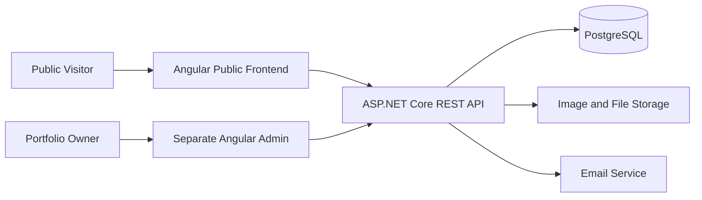
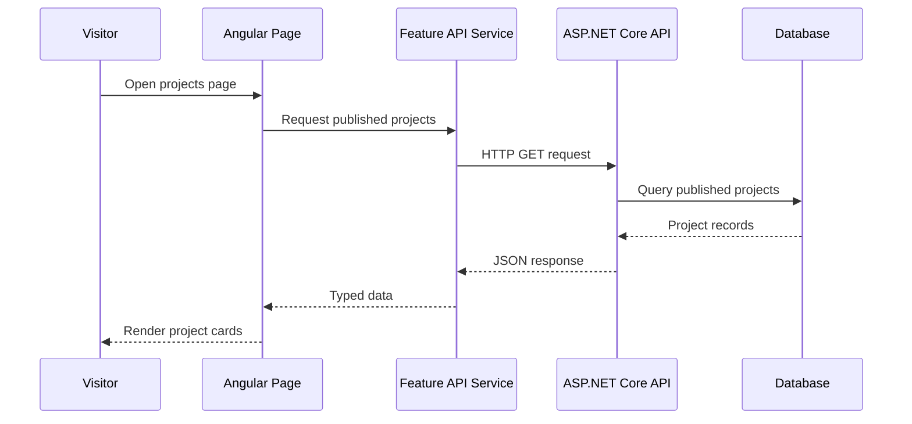

# Public Frontend Software Architecture

**Application:** Public Professional Portfolio  
**Framework:** Angular  
**Backend:** Separate ASP.NET Core REST API  
**Status:** Proposed architecture

## 1. Architectural goals
- Keep the public portfolio independent from the admin dashboard.
- Separate presentation, routing, API access, and feature concerns.
- Keep content API-driven rather than embedded in page components.
- Support SEO-friendly rendering for public pages.
- Avoid unnecessary architectural complexity.
- Provide loading, empty, error, and not-found experiences.

## 2. System context

The overall solution contains three separately maintained applications:
1. `jobayer-portfolio-web` — public Angular website.
2. `jobayer-portfolio-admin` — private Angular administration application.
3. `jobayer-portfolio-api` — ASP.NET Core backend and API.

This repository contains only the public frontend.



The public frontend must never include admin CRUD workflows or privileged backend operations.

## 3. Frontend architecture style

Use a feature-oriented Angular application with clear boundaries between:
- Application shell and layout
- Core cross-application services
- Shared reusable UI
- Feature pages and feature-specific components
- API data-access services
- Models and view models

This is a pragmatic frontend architecture. Do not reproduce backend Clean Architecture layers inside Angular without a concrete need.

## 4. Proposed repository structure

```text
jobayer-portfolio-web/
├── AGENTS.md
├── README.md
├── FRONTEND_PRD.md
├── docs/
│   ├── DESIGN_SYSTEM.md
│   ├── ROUTES_AND_NAVIGATION.md
│   ├── COMPONENT_CATALOG.md
│   ├── API_INTEGRATION.md
│   ├── CONTENT_MODEL.md
│   ├── SEO_AND_METADATA.md
│   ├── ACCESSIBILITY.md
│   ├── TESTING_QA.md
│   ├── ENVIRONMENT_AND_CONFIGURATION.md
│   ├── DEPLOYMENT.md
│   ├── DECISIONS.md
│   ├── OPEN_QUESTIONS.md
│   ├── TECH_STACK.md
│   └── SOFTWARE_ARCHITECTURE.md
├── public/
│   ├── favicon.ico
│   ├── robots.txt
│   └── assets/
│       ├── images/
│       └── documents/
├── src/
│   ├── app/
│   │   ├── core/
│   │   │   ├── config/
│   │   │   ├── http/
│   │   │   ├── services/
│   │   │   └── models/
│   │   ├── layout/
│   │   │   ├── site-shell/
│   │   │   ├── header/
│   │   │   └── footer/
│   │   ├── shared/
│   │   │   ├── components/
│   │   │   ├── directives/
│   │   │   └── pipes/
│   │   ├── features/
│   │   │   ├── home/
│   │   │   ├── about/
│   │   │   ├── experience/
│   │   │   ├── projects/
│   │   │   ├── skills/
│   │   │   ├── education/
│   │   │   ├── publications/
│   │   │   ├── certifications/
│   │   │   ├── blog/
│   │   │   └── contact/
│   │   ├── app.config.ts
│   │   └── app.routes.ts
│   ├── styles/
│   ├── index.html
│   └── main.ts
├── angular.json
├── package.json
├── tsconfig.json
└── ...
```

Angular CLI may generate a slightly different layout depending on its version and SSR options. Preserve the architectural boundaries even if filenames differ.

## 5. Responsibilities

### Core
Application-wide infrastructure:
- API base URL/configuration
- HTTP interceptors where needed
- Global error handling
- Shared application-level services
- Types genuinely shared across features

Do not use `core` as a dumping ground for feature-specific code.

### Layout
The site frame:
- Header
- Footer
- Navigation
- Main content shell

### Shared
Reusable UI primitives that do not belong to one feature:
- Buttons
- Tags
- Loading indicators
- Empty/error states
- Reusable form controls

Do not put feature-specific business logic in shared components.

### Features
Each feature owns its route-level pages, feature-specific components, models, and data-access logic where appropriate.

Example:

```text
features/projects/
├── pages/
│   ├── project-list-page/
│   └── project-detail-page/
├── components/
│   ├── project-card/
│   └── project-gallery/
├── data-access/
│   └── projects-api.service.ts
├── models/
│   └── project.model.ts
└── projects.routes.ts
```

Keep structure proportional to feature complexity; do not create empty folders preemptively.

## 6. Data flow



Rules:
- Pages coordinate presentation and user interaction.
- API services own HTTP communication.
- API response types align with the backend contract.
- Components must not assume a request succeeded before a response arrives.
- Render explicit loading, empty, and error states.

## 7. Routing and rendering
- Use Angular Router.
- Lazy-load route-level features where appropriate.
- Use stable public slugs for project and article details.
- Implement a custom not-found route.
- Add route-specific metadata.
- Evaluate SSR/prerendering for public routes.
- Never expose draft or unpublished content.

## 8. State management
Start with Angular Signals and local component state.
- Local state for menus, filters, and form interaction.
- Feature services for data loading and caching when needed.
- Shared state only when multiple unrelated components genuinely need it.

Do not add a global state library until complexity requires it.

## 9. Error handling
Handle network failures, server errors, validation errors, empty collections, missing detail records, and unavailable assets. Show user-friendly messages; never expose stack traces or internal backend diagnostics.

## 10. Security boundaries
- The public app consumes public API endpoints only.
- Admin authorization is enforced by the backend and admin application, not by hiding UI in the public app.
- Never include secrets in frontend source or build configuration.
- Treat API data and visitor input as untrusted.
- Avoid unsafe HTML rendering.
- Use HTTPS in production.
- Coordinate CORS, rate limiting, and security headers with the backend.

## 11. Performance and SEO
- Evaluate SSR or prerendering.
- Optimize images and reserve layout space.
- Lazy-load below-the-fold media.
- Keep route bundles appropriately sized.
- Provide unique metadata and canonical URLs.
- Generate sitemap and robots directives.
- Measure Core Web Vitals after deployment.

## 12. Testing boundaries
- Unit test utilities, services, and meaningful component logic.
- Component test interaction and accessibility behavior.
- E2E test important visitor journeys.
- Mock API responses for deterministic frontend tests.
- Add integration checks against a test API when available.

## 13. Architecture decision rules
Before introducing a new pattern or dependency, document the problem, why the current approach is insufficient, alternatives, and maintenance/bundle-size impact. Prefer the simplest design that meets requirements.

## 14. Pending architecture decisions
- Final Angular version and CLI options
- SSR vs prerendering vs CSR strategy
- Tailwind CSS vs SCSS
- API response envelope and OpenAPI generation approach
- Public content caching and revalidation strategy
- Hosting and deployment model
- Monitoring and error-reporting provider
